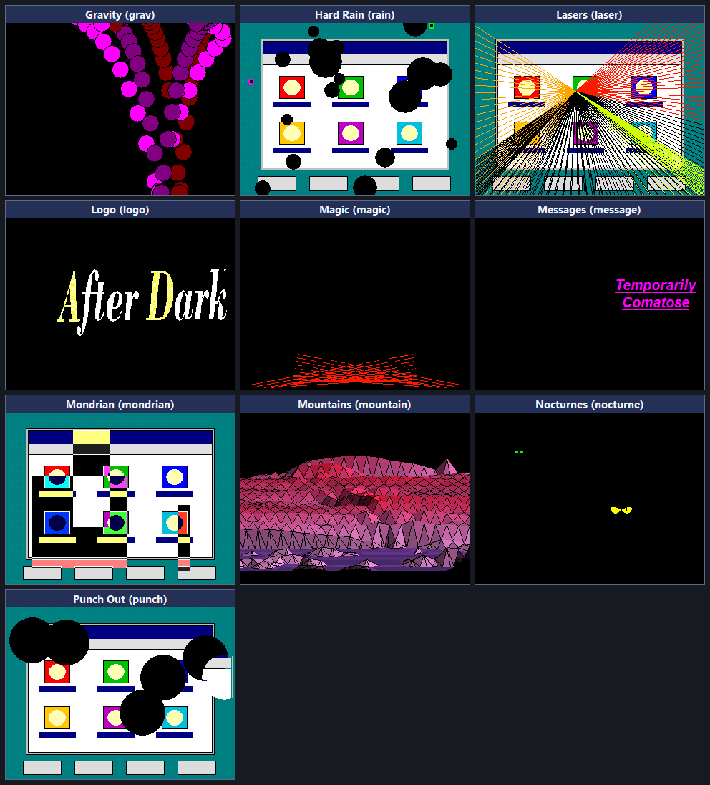
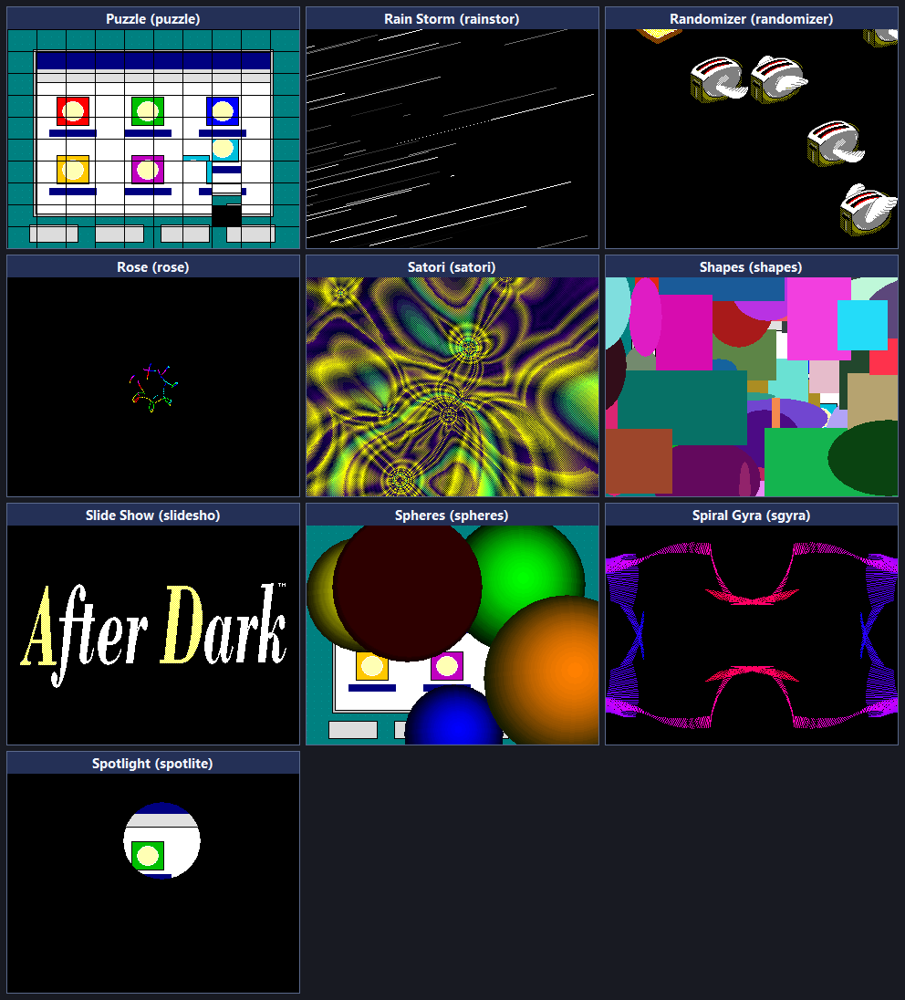

# After Dark 1.0a (1991) — Windows 11 Native Rust Port

A complete **1:1 disassembly-backed decompilation** and Windows 11 modernization of **Berkeley Systems' After Dark 1.0a for Windows (1991)** written in native Win64 Rust (`windows-sys`), including **all 37 screensaver modules** (all 34 `.AD` modules, both `AD.EXE` built-in savers, and the `ADMODULE.SDK` Blanker sample).

## Gallery — All 37 Built-in Screensavers

| Modules 1–10 | Modules 11–20 |
| :---: | :---: |
|  |  |

| Modules 21–30 | Modules 31–37 |
| :---: | :---: |
|  |  |

## Highlights

### 1. Floppy & Custom LZW Unpacker (`tools/`)
- [tools/unpack_floppy.py](tools/unpack_floppy.py) — Reads the 720 KB FAT12 `DISK01.IMG` and decompresses all 67 `.*$` payload files using the exact 9–14-bit MSB-first LZW algorithm reversed from `INSTALL.EXE` (`SEG 9`).
- [tools/ne_inspect.py](tools/ne_inspect.py) — Custom Win16 NE (New Executable) parser, relocation/ordinal resolver, resource extractor, and Capstone 16-bit x86 disassembler.
- [tools/dump_phase1.py](tools/dump_phase1.py) — Extracts lossless original `.bmp`, `.ico`, `.cur`, `TYPE_1000` (`AD_CONTROL`), and `TYPE_2000` (`AD_STRING`) resources plus annotated disassemblies into `assets/` and `docs/disasm/`.

### 2. Modernized Win64 After Dark SDK (`crates/ad-sdk` & `crates/ad-blanker-sdk-example`)
- 1:1 Rust port of `ADMODULE.SDK` (`MODULE.H` + `RES_IDS.H`), including:
  - Exact Microsoft C 6.0 `srand`/`rand` LCG (`MsvcRand`).
  - Exact 235-entry palettes (`HSV_PAL`, `RGB_PAL`, `WHITE_PAL`, `PRIMARY_PAL`) decompiled from `AD.EXE` `SEG 13`.
  - Exact `AD.EXE` `SEG 13` slider value mapping formulas (`LabeledSlider` & `NumericSlider`).
  - Native Win32 GDI offscreen DIB canvas (`AdSurface`) preserving true 1-bpp monochrome `HBITMAP` semantics (including 3-operand ROPs like `DSPDxax = 0x00E20746`) + crisp nearest-neighbor (`COLORONCOLOR`) integer scaling (`1x / 2x / 3x / Auto`).
  - Non-blocking WinMM `waveOut` retro PC-speaker synthesizer (`AdSound`) replacing Windows 3.0 `SOUND.DRV`.
  - 1:1 `AD_PREFS.INI` (including `SEG 10` password codec), 41-byte binary `RANDOM.ADS`, 1968-byte binary `MESSAGES.ADS`, and 4-section `GRAFSTAT.TXT` compatibility.
  - Modernized Win64 C-ABI dynamic `.dll` plugin loader (`ad_module_entry_v1` / `ad_module_metadata_v1`) demonstrated by `crates/ad-blanker-sdk-example` (port of `ADMODULE.SDK\BLANKER`).

### 3. All 37 Built-in 1:1 Decompiled Modules (`crates/ad-modules`)

| Module | Original Binary | Highlights |
|---|---|---|
| **Aquatic Realm** | `AQUA.AD` | All 76 original sprites (angelfish, seahorses, butterflyfish, crabs, jellyfish, kelp, gravel), 40-fish school, bubbles & water-column depth |
| **Blanker** | `ADMODULE.SDK` | Solid-black blanker + loadable external Win64 `.dll` SDK sample |
| **Can of Worms** | `WORMS.AD` | Rainbow segmented worms burrowing across the captured live desktop |
| **Clocks** | `CLOCKS.AD` | All 14 original bitmaps (`Modern`, `Antique`, `Digital` 0–9), exact trig tables, PC-speaker tick & hourly chime |
| **Down the Drain** | `DRAINO.AD` | Rotating spiral vortex draining the captured desktop into black |
| **Fade Away** | `FADE.AD` | 1:1 1991 wipe/spiral pixel-fade styles erasing the captured desktop |
| **Flying Toasters** | `TOASTERS.AD` | All 12 original 64×64 sprites, exact wing cycle, collision avoidance, toast darkness |
| **GeoBounce** | `3DBOUNCE.AD` | 5 shaded 3D Platonic solids (Tetrahedron..Icosahedron) bouncing & spinning |
| **Globe** | `GLOBE.AD` | 3D orthographic spinning Earth with `EARTH.BMP` + custom `.BMP` map picker (`Map...`) |
| **GraphStat** | `GRAFSTAT.AD` | Meaningless radar/bar/line charts with authentic `GRAFSTAT.TXT` & native editor (`Edit..`) |
| **Gravity** | `GRAV.AD` | Shaded spheres bouncing under gravity with parabolic trails |
| **Hard Rain** | `RAIN.AD` | Expanding circular raindrops eroding the captured desktop |
| **Lasers** | `LASER.AD` | Sweeping multi-color laser fans over black or live desktop |
| **Logo** | `LOGO.AD` | Bouncing `ADLOGO.BMP` with custom `.BMP` picture picker (`Picture..`) |
| **Magic** | `MAGIC.AD` | Classic 1991 geometric ribbon line-art trails |
| **Messages** | `MESSAGE.AD` | Bouncing styled messages reading/writing authentic 1968-byte `MESSAGES.ADS` (`Edit...`) |
| **Mondrian** | `MONDRIAN.AD` | Overlapping rectangular XOR/color patches over live desktop |
| **Mountains** | `MOUNTAIN.AD` | Triangle-midpoint fractal landscapes, all 9 solar-system planets, 5 views & shoreline clipping |
| **Nocturnes** | `NOCTURNE.AD` | Original 102×80 `EYES` sprite sheet (5 styles × 3 blink frames) & `DSPDxax` blink state machine |
| **Punch Out** | `PUNCH.AD` | Circular desktop chunks punched out and bounced around the screen |
| **Puzzle** | `PUZZLE.AD` | Live desktop sliced into a classic sliding-tile puzzle |
| **Rain Storm** | `RAINSTOR.AD` | Wind-driven slanted rain streaks with occasional lightning flashes |
| **Randomizer** | `AD.EXE SEG 16` | Random / In Order cycling across all modules with `Choose..` dialog & `RANDOM.ADS` |
| **Rose** | `ROSE.AD` | Parametric rainbow mathematical rose curves |
| **Satori** | `SATORI.AD` | All 13 color themes, 5 interference fields + checkerboard Mix, spiral refinement, live palette cycling & Caps Lock flip |
| **Shapes** | `SHAPES.AD` | Overlapping colorful rectangles, ellipses, and polygons |
| **Slide Show** | `SLIDESHO.AD` | Transitioning `.BMP` slide deck (`ADLOGO`, `BSILOGO`, `EARTH`, or any folder via `Pictures..`) |
| **Spheres** | `SPHERES.AD` | Smoothly shaded 3D spheres popping onto the screen |
| **Spiral Gyra** | `SGYRA.AD` | Symmetric harmonic spirograph line-art webs |
| **Spotlight** | `SPOTLITE.AD` | Circular spotlight sweeping across the live desktop (preserves desktop during live Demo resize) |
| **Stained Glass** | `STAINED.AD` | 8-way kaleidoscopic quilt generator with random walkers, motifs & 3×3 / checkerboard / ring tiling |
| **Starry Night** | `AD.EXE SEG 2` | Twinkling starfield, `HRGN` city skyline, lit windows, aircraft beacon, shooting stars & lightning |
| **String Theory** | `STRING.AD` | Sweeping multi-point Bézier string-art curves |
| **Vertigo** | `VERTIGO.AD` | Shrinking concentric spirals, cones & shapes with 256-color `AnimatePalette` cycling |
| **Warp!** | `WARP.AD` | 3D spiraling warp-speed starfield |
| **Wrap Around** | `WRAP.AD` | Rainbow figure-8 Lissajous wrapping ribbons |
| **Zot!** | `ZOT.AD` | Forked single- & double-flash jagged lightning bolts |

### 4. Native Windows 11 Host (`crates/ad-host` → `after-dark.exe`)
- **Retro Windows 3.1 Control Panel** by default (original `LOGO` + red `LMETEOR`, clickable `ON_SW`/`OFF_SW` toggle switch, beveled 3D gray platforms, authentic 4-slot dynamic module controls, credits & About dialogs) with a **1-click toggle to Modern Windows 11 Dark UI** (DWM dark titlebar, rounded corners, dark card styling, Segoe UI).
- **Native Win32 Module Editors & Pickers**:
  - `Randomizer` → `Choose..` multi-select dialog (`RANDOM.ADS`)
  - `Messages` → `Edit...` 8-slot rich message editor (`MESSAGES.ADS`)
  - `GraphStat` → `Edit..` 4-section multiline text editor (`GRAFSTAT.TXT`)
  - `Logo` (`Picture..`) & `Globe` (`Map...`) → native `.BMP` file picker (`GetOpenFileNameW`)
  - `Slide Show` (`Pictures..`) → native folder picker (`SHBrowseForFolderW`)
- **System Tray daemon** using original `AD` (active) and `INACTIVE` (X-over) icons.
- **Hot Corners** (`Sleep Now` / `Never Sleep`), **Global Idle Monitor**, **Global Hotkey** (`Ctrl+Shift+S`), **Shift+Sleep** solid-black blanking, and **Ctrl-at-launch** disabled startup.
- **Multi-Monitor** (`Per-Monitor`, `Spanned`, `Primary Only`) & **High-DPI 4K Integer Scaling** (`Auto`, `1x`, `2x`, `3x`).
- **Live Demo Mode** animating behind the Control Panel with real-time slider updates.

## Build, Verify & Run

```powershell
cargo test --workspace
cargo build --workspace --release
.\target\release\after-dark.exe
```

`cargo test --workspace` executes automated checks on all 37 modules plus `AD_PREFS.INI`, `RANDOM.ADS`, `MESSAGES.ADS`, `GRAFSTAT.TXT`, and the external Win64 SDK `.dll` plugin, and exports 4 visual contact sheets to `target/verify_snapshots/sheet_1.png..sheet_4.png`.

Optional CLI flags:
- `--sleep` — Immediately engage fullscreen screensaver.
- `--tray` — Start minimized to the System Tray.
