# After Dark v2.0 — Windows 11 Native Rust Port (77 Built-in Screensavers)

A complete **disassembly- & resource-backed native Win64 Rust port** (`windows-sys`) of **Berkeley Systems' After Dark** for Windows 11, uniting **all 77 classic screensaver modules** across four legendary collections into a single standalone executable (`after-dark.exe`):

- **Classic After Dark 1.0a (1991)** — **37 modules** (all 34 `.AD` modules, both `AD.EXE` built-in savers, and the `ADMODULE.SDK` Blanker sample)
- **The Simpsons After Dark (1994)** — **15 modules** (2,647 `RLEP` frames, 12,175 `OFst`/`OFtb` compound poses, 87 digitized cast voice clips, 9 polyphonic MIDI songs)
- **Star Trek: The Next Generation After Dark (1994)** — **13 modules** (1,518 `RLEP` frames, 3,240 `OFst`/`OFtb` compound poses, 56 bridge/cast audio clips, 2 MIDI scores)
- **Looney Tunes After Dark (1995)** — **12 modules** (2,050 `RLEP` frames, 8,534 `OFst`/`OFtb` compound poses, 103 cast voice/SFX clips including MACE 3:1 ADPCM audio, 13 MIDI cartoon themes)

---

## Visual Galleries

### Looney Tunes Collection (1995 — All 12 Modules)

| Looney Tunes (1–6) | Looney Tunes (7–12) |
| :---: | :---: |
| 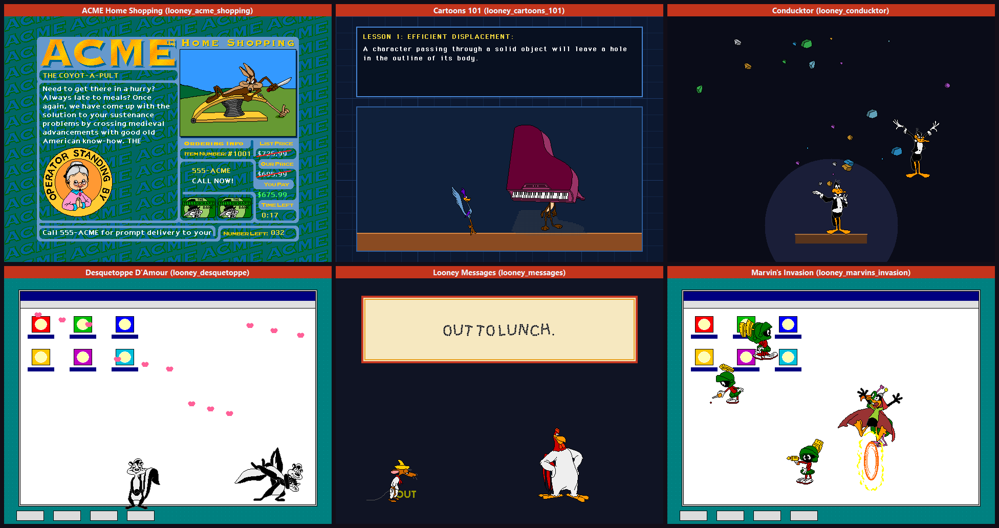 | 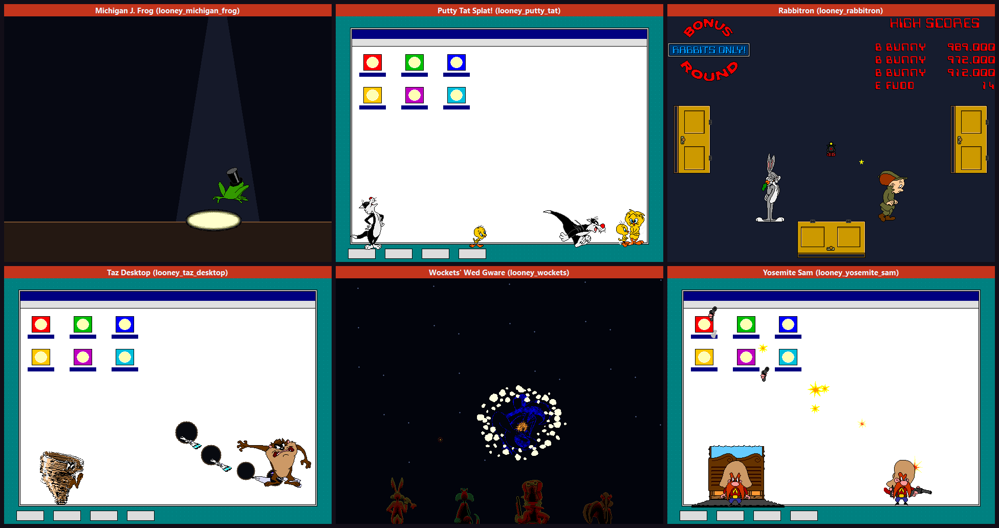 |

### The Simpsons Collection (1994 — All 15 Modules)

| The Simpsons (1–9) | The Simpsons (10–15) |
| :---: | :---: |
| 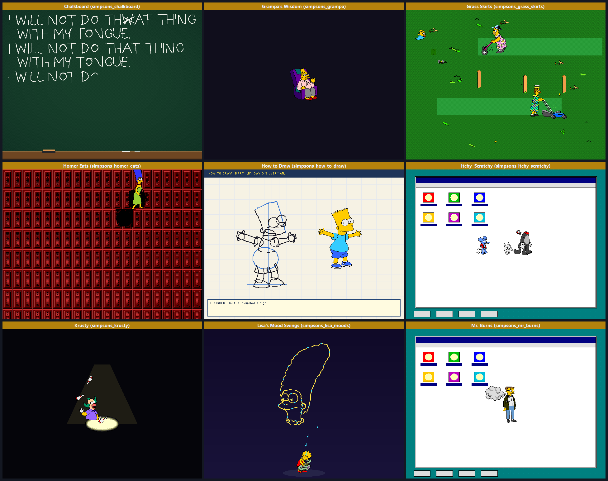 | 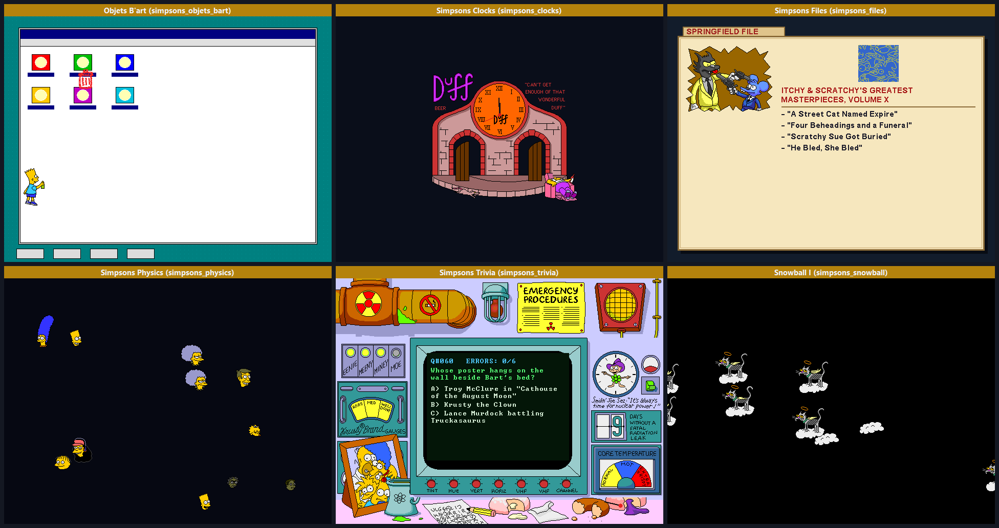 |

### Star Trek: The Next Generation Collection (1994 — All 13 Modules)

| Star Trek: TNG (1–9) | Star Trek: TNG (10–13) |
| :---: | :---: |
| 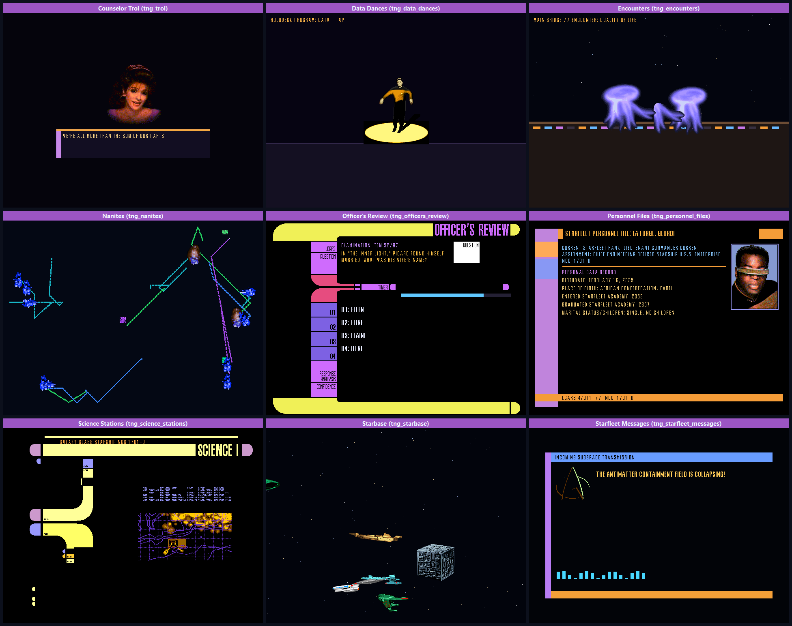 | 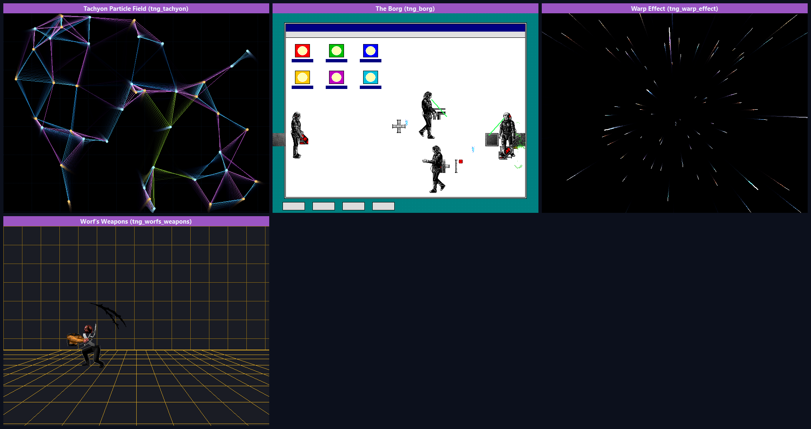 |

### Full 77-Module Catalog Contact Sheets (Alphabetical)

| Modules 1–10 | Modules 11–20 |
| :---: | :---: |
| 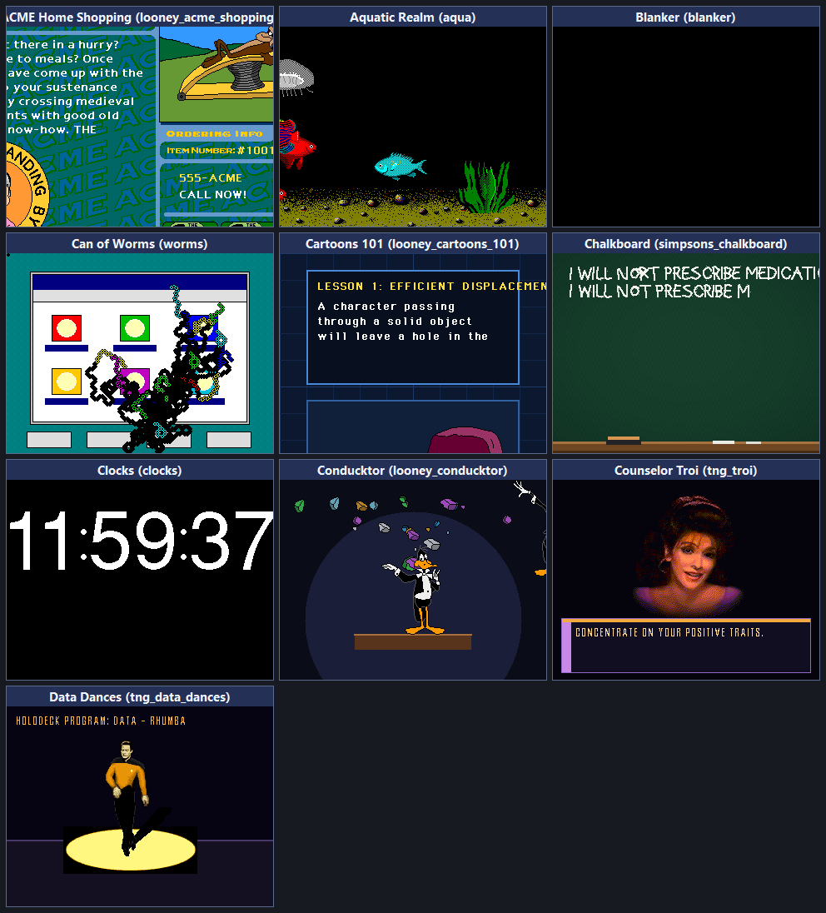 |  |

| Modules 21–30 | Modules 31–40 |
| :---: | :---: |
|  | 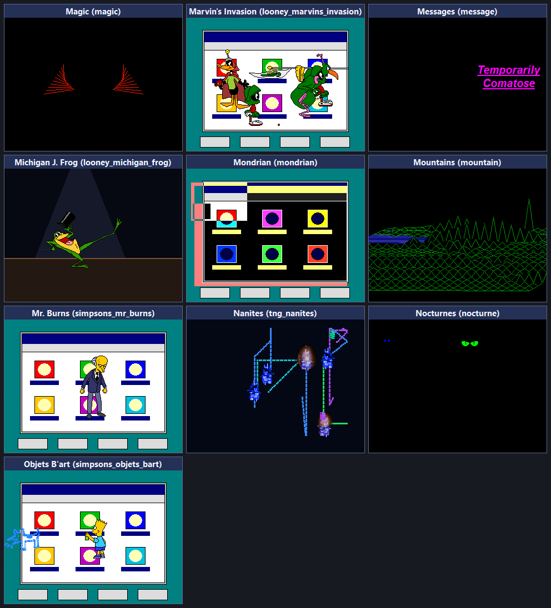 |

| Modules 41–50 | Modules 51–60 |
| :---: | :---: |
| 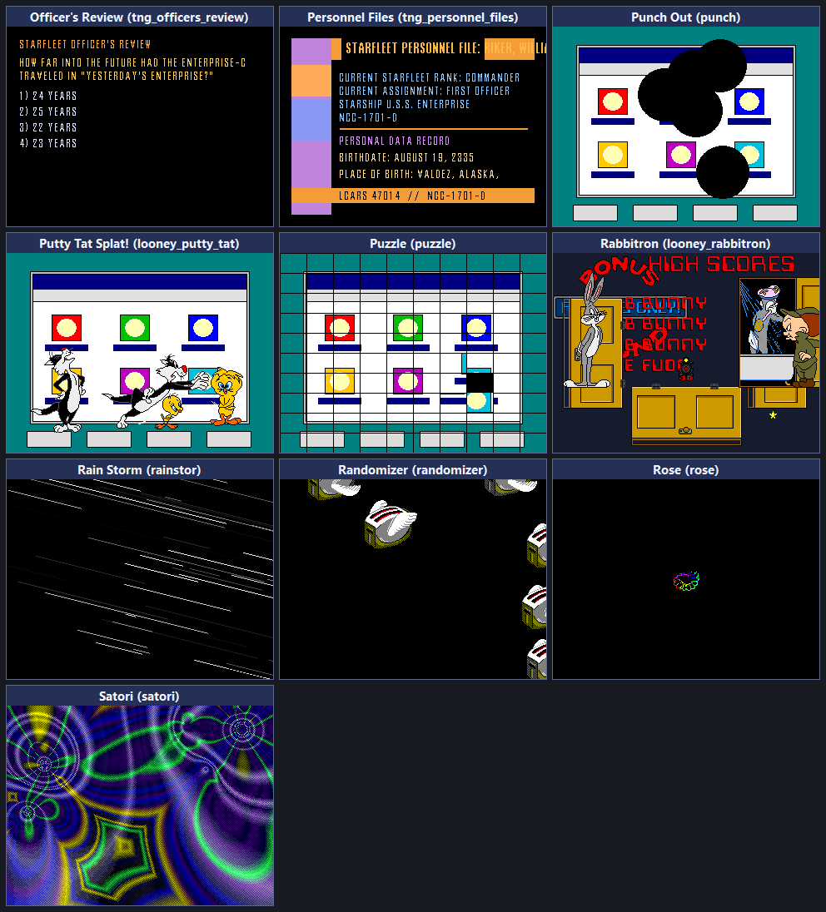 | 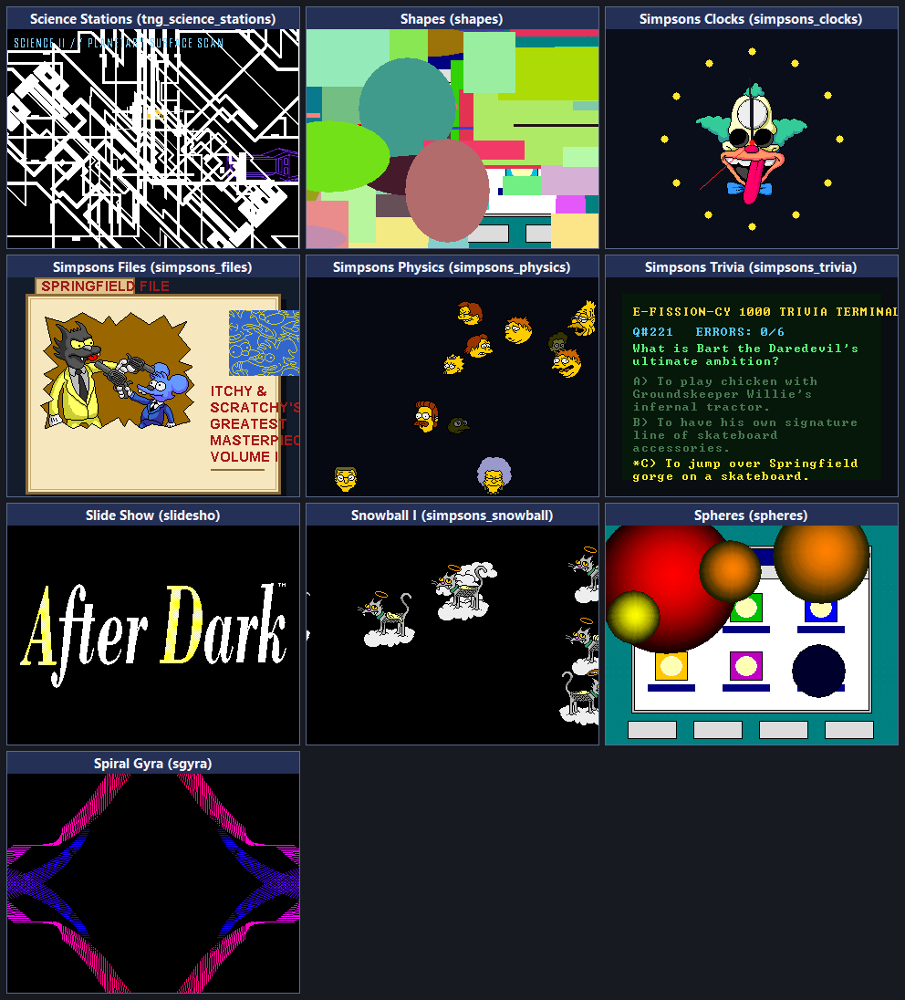 |

| Modules 61–70 | Modules 71–77 |
| :---: | :---: |
| 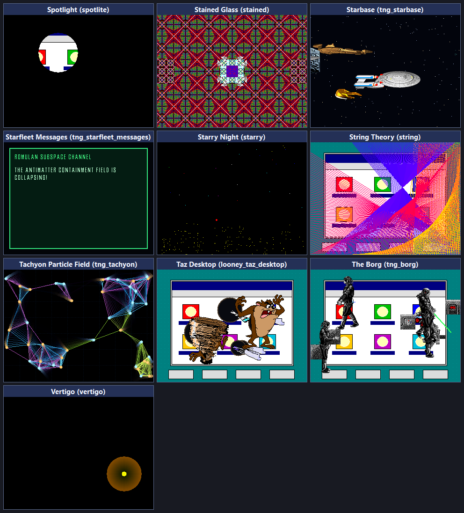 | 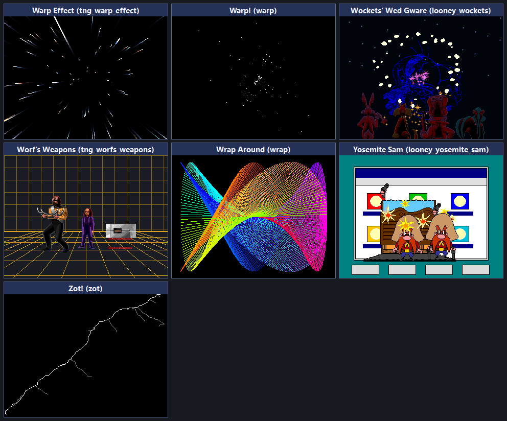 |

---

## What's New in Version 2.0

1. **77 Built-in Screensavers Across 4 Collections**:
   - Complete integration of **Classic 1991 (`37`)**, **The Simpsons (`15`)**, **Star Trek: The Next Generation (`13`)**, and **Looney Tunes (`12`)** with all original `RLEP`/`OFst`/`OFtb` compound animations, custom bitmap fonts, trivia databases, digitized cast voices (`WinMM waveOut`), and polyphonic Standard MIDI (`WinMM midiOutShortMsg`) music.
2. **Real Windows 11 Desktop Overlay for All Desktop-Interacting Modules**:
   - Desktop modules (*Homer Eats*, *Grass Skirts*, *Itchy & Scratchy*, *Objets d'Bart*, *Snowball II*, *Bad Dog!*, *Borg*, *Crystalline Entity*, *Parallels*, *Desquetoppe D'Amour*, *Putty Tat Splat!*, *Taz Desktop*, *Yosemite Sam*, *Marvin's Invasion*, *Can of Worms*, *Down the Drain*, *Hard Rain*, *Punch Out*, *Puzzle*, *Spotlight*) capture and animate directly over your live Windows 11 desktop.
3. **Frame Rate & Smoothness Modes (`When / Setup...`)**:
   - **Authentic Retro (15–30 FPS)** — Original 1991–1995 module frame pacing (`target_frame_ms`).
   - **Smooth 60 FPS** — 16 ms frame pacing for silky movement on modern displays.
   - **High Refresh 120+ FPS** — 8 ms frame pacing for high-refresh monitors.
4. **6 Display Scale & Filter Modes (`When / Setup...`)**:
   - **Auto (Smart Retro 2x / 3x)** — Automatically chooses integer pixel scaling for 1080p/1440p/4K displays.
   - **1x (Native Monitor Pixels)** — Full monitor resolution.
   - **2x (Crisp Integer Pixel Art)** — Nearest-neighbor 2× pixel art scaling.
   - **3x (Crisp 4K Integer)** — Nearest-neighbor 3× pixel art scaling.
   - **640×480 Classic 4:3 Stage** — Authentic 640×480 4:3 canvas centered with aspect-correct pillarboxing on widescreen monitors.
   - **2x Retro CRT Scanlines** — 2× integer scaling with a classic CRT scanline overlay.
5. **Collection Filter, Live Search Box & Favorites (`★ Fav`)**:
   - Filter the Control Panel module list by collection (**All Collections (77)**, **Classic 1991 (37)**, **The Simpsons (15)**, **Star Trek: TNG (13)**, **Looney Tunes (12)**, **★ Favorites**), search live across all 77 modules, and star your favorites with one click.
6. **Audio Mixer & Test Audio Button (`When / Setup...`)**:
   - Independent **Voice / SFX Volume (0–100%)** and **MIDI Music Volume (0–100%)** controls with real-time PCM/tone amplitude scaling and MIDI velocity/CC#7 scaling, plus a **Test Audio** button.
7. **Pack-Aware Randomizer & One-Click Playlists (`Randomizer` → `Choose...`)**:
   - Every module in the Randomizer selector shows its `[Classic]`, `[Simpsons]`, `[Star Trek]`, or `[Looney Tunes]` collection badge, with 8 one-click preset buttons: **All (76)**, **Classic 1991**, **Simpsons**, **Star Trek**, **Looney Tunes**, **All Cartoons**, **★ Favorites**, and **Clear All**.
8. **4 Multi-Monitor Modes (`When / Setup...`)**:
   - **Independent Per Monitor (Same Module)** — Each display runs its own independent instance of the active module.
   - **Different Module Per Monitor (Random Pool)** — Each connected monitor runs a different screensaver chosen from your Randomizer pool simultaneously.
   - **Spanned Across All Monitors** — A single unified virtual-desktop canvas across all displays.
   - **Primary Monitor Only** — Runs on the primary display only.

---

## Complete Catalog of All 77 Built-in Screensavers

### Collection 1: Classic After Dark 1.0a (1991 — 37 Modules)

| Module | Original Binary | Highlights |
|---|---|---|
| **Aquatic Realm** | `AQUA.AD` | All 76 original sprites (angelfish, seahorses, butterflyfish, crabs, jellyfish, kelp, gravel), 40-fish school, bubbles & water-column depth |
| **Blanker** | `ADMODULE.SDK` | Solid-black blanker + loadable external Win64 `.dll` SDK sample |
| **Can of Worms** | `WORMS.AD` | Rainbow segmented worms burrowing across the captured live desktop |
| **Clocks** | `CLOCKS.AD` | All 14 original bitmaps (`Modern`, `Antique`, `Digital` 0–9), exact trig tables, PC-speaker tick & hourly chime |
| **Down the Drain** | `DRAINO.AD` | Rotating spiral vortex draining the captured desktop into black |
| **Fade Away** | `FADE.AD` | 1:1 1991 wipe/spiral pixel-fade styles erasing the captured desktop |
| **Flying Toasters** | `TOASTERS.AD` | All 12 original 64×64 sprites, exact wing cycle, collision avoidance, toast darkness |
| **GeoBounce** | `3DBOUNCE.AD` | 5 shaded 3D Platonic solids (Tetrahedron..Icosahedron) bouncing & spinning |
| **Globe** | `GLOBE.AD` | 3D orthographic spinning Earth with `EARTH.BMP` + custom `.BMP` map picker (`Map...`) |
| **GraphStat** | `GRAFSTAT.AD` | Meaningless radar/bar/line charts with authentic `GRAFSTAT.TXT` & native editor (`Edit..`) |
| **Gravity** | `GRAV.AD` | Shaded spheres bouncing under gravity with parabolic trails |
| **Hard Rain** | `RAIN.AD` | Expanding circular raindrops eroding the captured desktop |
| **Lasers** | `LASER.AD` | Sweeping multi-color laser fans over black or live desktop |
| **Logo** | `LOGO.AD` | Bouncing `ADLOGO.BMP` with custom `.BMP` picture picker (`Picture..`) |
| **Magic** | `MAGIC.AD` | Classic 1991 geometric ribbon line-art trails |
| **Messages** | `MESSAGE.AD` | Bouncing styled messages reading/writing authentic 1968-byte `MESSAGES.ADS` (`Edit...`) |
| **Mondrian** | `MONDRIAN.AD` | Overlapping rectangular XOR/color patches over live desktop |
| **Mountains** | `MOUNTAIN.AD` | Triangle-midpoint fractal landscapes, all 9 solar-system planets, 5 views & shoreline clipping |
| **Nocturnes** | `NOCTURNE.AD` | Original 102×80 `EYES` sprite sheet (5 styles × 3 blink frames) & `DSPDxax` blink state machine |
| **Punch Out** | `PUNCH.AD` | Circular desktop chunks punched out and bounced around the screen |
| **Puzzle** | `PUZZLE.AD` | Live desktop sliced into a classic sliding-tile puzzle |
| **Rain Storm** | `RAINSTOR.AD` | Wind-driven slanted rain streaks with occasional lightning flashes |
| **Randomizer** | `AD.EXE SEG 16` | Random / In Order cycling across all modules with `Choose..` dialog & `RANDOM.ADS` |
| **Rose** | `ROSE.AD` | Parametric rainbow mathematical rose curves |
| **Satori** | `SATORI.AD` | All 13 color themes, 5 interference fields + checkerboard Mix, spiral refinement, live palette cycling & Caps Lock flip |
| **Shapes** | `SHAPES.AD` | Overlapping colorful rectangles, ellipses, and polygons |
| **Slide Show** | `SLIDESHO.AD` | Transitioning `.BMP` slide deck (`ADLOGO`, `BSILOGO`, `EARTH`, or any folder via `Pictures..`) |
| **Spheres** | `SPHERES.AD` | Smoothly shaded 3D spheres popping onto the screen |
| **Spiral Gyra** | `SGYRA.AD` | Symmetric harmonic spirograph line-art webs |
| **Spotlight** | `SPOTLITE.AD` | Circular spotlight sweeping across the live desktop (preserves desktop during live Demo resize) |
| **Stained Glass** | `STAINED.AD` | 8-way kaleidoscopic quilt generator with random walkers, motifs & 3×3 / checkerboard / ring tiling |
| **Starry Night** | `AD.EXE SEG 2` | Twinkling starfield, `HRGN` city skyline, lit windows, aircraft beacon, shooting stars & lightning |
| **String Theory** | `STRING.AD` | Sweeping multi-point Bézier string-art curves |
| **Vertigo** | `VERTIGO.AD` | Shrinking concentric spirals, cones & shapes with 256-color `AnimatePalette` cycling |
| **Warp!** | `WARP.AD` | 3D spiraling warp-speed starfield |
| **Wrap Around** | `WRAP.AD` | Rainbow figure-8 Lissajous wrapping ribbons |
| **Zot!** | `ZOT.AD` | Forked single- & double-flash jagged lightning bolts |

### Collection 2: The Simpsons After Dark (1994 — 15 Modules)

| Module | ID | Highlights |
|---|---|---|
| **Bart's Chalkboard** | `simpsons_chalkboard` | Bart writes all 30 authentic episode chalkboard gags (`CSTR #1300`) in bitmap handwriting font (`RLEP #1500`) before skateboarding off |
| **Files of Springfield** | `simpsons_files` | Springfield Elementary personnel folder cabinet with animated character tabs, mugshots, and biographies |
| **Grampa's Tales** | `simpsons_grampa` | Abe Simpson rambles through meandering stories (`HSTR`) in the Retirement Castle with 21 digitized voice clips & snores |
| **Grass Skirts** | `simpsons_grass_skirts` | Hula-dancing Homer, Marge, Bart, Lisa, and Maggie parade across the Windows desktop to polyphonic Hawaiian MIDI themes |
| **Homer Eats** | `simpsons_homer_eats` | Giant Homer chomps actual bite holes out of your live Windows desktop (`RLEP #12000`) while shouting *"Mmm... donuts!"* and *"D'oh!"* |
| **How To Draw Bart** | `simpsons_how_to_draw` | Step-by-step animator's pencil & ink construction of Bart Simpson on an artist's drawing board |
| **Itchy & Scratchy** | `simpsons_itchy_scratchy` | Cartoon chase and mallet mayhem across the live Windows desktop with the *Itchy & Scratchy* MIDI theme song |
| **Krusty the Clown** | `simpsons_krusty` | Krusty juggling, laughing (`"Hey hey, kids!"`), and getting pied in his television studio |
| **Lisa's Moods** | `simpsons_lisa_moods` | Lisa improvises Happy & Angry saxophone solos (`LISA` choreographed notes + MIDI sax scores) |
| **Mr. Burns** | `simpsons_mr_burns` | Montgomery Burns and Smithers monitor the Nuclear Power Plant security cameras (`"Excellent..."`) |
| **Objets d'Bart** | `simpsons_objets_bart` | Bart sprays graffiti tags, slingshots, and skateboards directly onto your captured Windows desktop |
| **Physics With Frink** | `simpsons_physics` | Professor Frink's chalkboard physics demonstrations (`"Glayvin!"`) with animated mechanical contraptions |
| **Simpsons Clocks** | `simpsons_clocks` | Live functional wall clocks (`SCLO`) featuring Homer, Bart, Krusty, and Maggie with animated eyes and pendulums |
| **Snowball II** | `simpsons_snowball` | Snowball II stalks, pounces, and scratches claw marks across the live Windows desktop |
| **Springfield Trivia** | `simpsons_trivia` | Interactive multi-category *Simpsons* trivia quiz (`QERY`) with scoreboard and cast reactions |

### Collection 3: Star Trek: The Next Generation After Dark (1994 — 13 Modules)

| Module | ID | Highlights |
|---|---|---|
| **Ascension** | `tng_ascension` | Worf's Klingon Rite of Ascension chamber with Painstik gauntlets and Klingon battle cries |
| **Bad Dog!** | `tng_bad_dog` | Alien shapeshifter morphing from a glowing orb into a creature prowling across your Windows desktop |
| **Borg** | `tng_borg` | Borg Cube tractor beams, green assimilation grid lasers, and *"Resistance is futile"* voice clips over your desktop |
| **Communicator** | `tng_communicator` | Starfleet LCARS comm badge & incoming subspace hail transmissions from Picard, Riker, Data, Worf & Geordi |
| **Crystalline Entity** | `tng_crystalline` | Refracting fractal Crystalline Entity shattering crystal shards out of your live Windows desktop |
| **Data** | `tng_data` | Lt. Commander Data painting at his easel, reciting Ode to Spot, and petting Spot the cat |
| **Encounter at Farpoint** | `tng_farpoint` | Spaceborne Farpoint jellyfish entities pulsing with bioluminescent color spectra in orbit |
| **Enterprise** | `tng_enterprise` | USS *Enterprise* NCC-1701-D cruising at impulse and jumping to warp flash across a deep-space nebula starfield |
| **Holodeck 3** | `tng_holodeck` | Yellow/black Holodeck wireframe grid materializing 3D holographic simulations |
| **Number One** | `tng_number_one` | Commander Riker playing jazz trombone solos in Ten Forward with floating musical notes |
| **Parallels** | `tng_parallels` | Quantum fissure tears opening across the Windows desktop as alternate-reality *Enterprise* ships emerge |
| **Scotty's Files** | `tng_scottys_files` | Captain Montgomery Scott's animated LCARS technical schematics & Starfleet vessel blueprints |
| **TNG Trivia** | `tng_trivia` | Full LCARS bridge console *Star Trek: TNG* trivia computer (`QERY`) with categories, timer, and ranks |

### Collection 4: Looney Tunes After Dark (1995 — 12 Modules)

| Module | ID | Highlights |
|---|---|---|
| **ACME Home Shopping** | `looney_acme_shopping` | Wile E. Coyote's live TV shopping network pitching all 12 original ACME contraptions (`STR# #2000..#2006`) with Granny Operator Standing By |
| **Cartoons 101** | `looney_cartoons_101` | Blueprint university lecture board teaching the 10 Cartoon Laws of Physics (`STR# #11000`) with Wile E. Coyote & Road Runner |
| **Conducktor** | `looney_conducktor` | Maestro Daffy Duck conducting Verdi's *Anvil Chorus* (`#70`) and Tchaikovsky's *1812 Overture* (`#80`) with rising colored notes & falling safes |
| **Desquetoppe D'Amour** | `looney_desquetoppe` | Pepé Le Pew wooingly bounding after Penelope Pussycat across your real Windows desktop with rising hearts and French romance |
| **Looney Messages** | `looney_messages` | Speedy Gonzales & Foghorn Leghorn delivering custom parchment banner messages (`"OUT TO LUNCH."`) in authentic `RLEP #7500` font |
| **Marvin's Invasion** | `looney_marvins_invasion` | Marvin the Martian and Duck Dodgers in the 24½th Century dueling with disintegrator pistols over your live Windows desktop |
| **Michigan J. Frog** | `looney_michigan_frog` | Spotlighted theater stage where Michigan J. Frog performs *"Hello! Ma Baby"* (`#10`) in top hat & cane—and croaks when caught |
| **Putty Tat Splat!** | `looney_putty_tat` | Sylvester stalking Tweety Bird across your real Windows desktop until Tweety drinks Dr. Jekyll's Formula and turns into Monster Tweety |
| **Rabbitron** | `looney_rabbitron` | Retro arcade high-score cabinet (`B BUNNY 989,000 / E FUDD 14`) where Bugs Bunny outsmarts Elmer Fudd through teleporting doors |
| **Taz Desktop** | `looney_taz_desktop` | Tasmanian Devil spinning across your real Windows desktop, chewing bite holes directly out of the screen and spitting out scraps |
| **Wockets' Wed Gware** | `looney_wockets` | Bugs, Daffy, Elmer & Yosemite Sam silhouetted at the bottom of the screen watching Looney Tunes character fireworks burst in the night sky |
| **Yosemite Sam** | `looney_yosemite_sam` | Yosemite Sam bursting out of saloon doors directly onto your real Windows desktop and blasting six-shooter bullet holes |

---

## Archive & Resource Extraction Pipeline (`tools/`)

- [tools/unpack_floppy.py](tools/unpack_floppy.py) — Reads the 1991 720 KB FAT12 `DISK01.IMG` and decompresses all 67 `.*$` payload files using the exact 9–14-bit MSB-first LZW algorithm reversed from `INSTALL.EXE` (`SEG 9`).
- [tools/ne_inspect.py](tools/ne_inspect.py) & [tools/dump_phase1.py](tools/dump_phase1.py) — Win16 NE (New Executable) parser, relocation/ordinal resolver, resource extractor, and Capstone 16-bit x86 disassembler.
- [tools/unpack_sit5.py](tools/unpack_sit5.py) — Pure-Python StuffIt 5 (`SIT5`) archive unpacker (Method 15 LZSS + Huffman) for *The Simpsons* and *Star Trek: TNG* Macintosh archives.
- [tools/unpack_sit_m13.py](tools/unpack_sit_m13.py) — Pure-Python StuffIt Deluxe (`SIT!`) Method 13 archive unpacker (37-symbol meta-Huffman + 5 static/dynamic LZSS+Huffman table sets + CRC-16 verification) for *Looney Tunes*.
- [tools/extract_simpsons.py](tools/extract_simpsons.py), [tools/extract_tng.py](tools/extract_tng.py) & [tools/extract_looney.py](tools/extract_looney.py) — Macintosh resource fork parsers that extract `RLEP`, `OFst`, `OFtb`, `clut`, `QERY`, `STR#`, `CSTR`, `HSTR`, `LISA`, `SCLO`, Apple MACE 3:1 ADPCM & uncompressed `snd ` clips (`PCM8`), and `SONG`/`MIDI` arrangements (`SMF Type 1`) into `assets/simpsons/simpsons.adp`, `assets/tng/tng.adp`, and `assets/looney/looney.adp`.

---

## Build, Verify & Run

```powershell
cargo test --workspace
cargo build --workspace --release
.\target\release\after-dark.exe
```

`cargo test --workspace` executes automated rendering, audio/resource integrity, and pixel-variance checks across all **77 built-in modules** plus `AD_PREFS.INI`, `RANDOM.ADS`, `MESSAGES.ADS`, `GRAFSTAT.TXT`, and the external Win64 SDK `.dll` plugin, and exports all 14 visual contact sheets to `target/verify_snapshots/`.

Optional CLI flags:
- `--sleep` — Immediately engage fullscreen screensaver.
- `--tray` — Start minimized to the System Tray.
